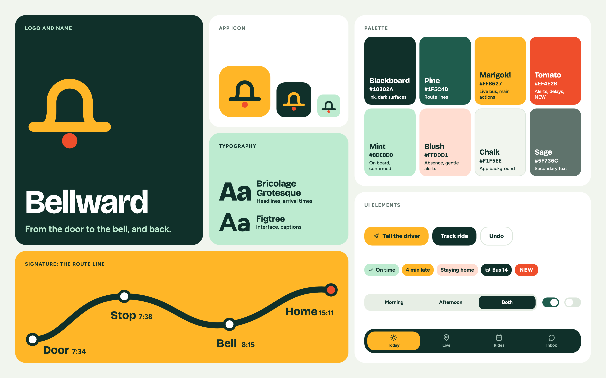
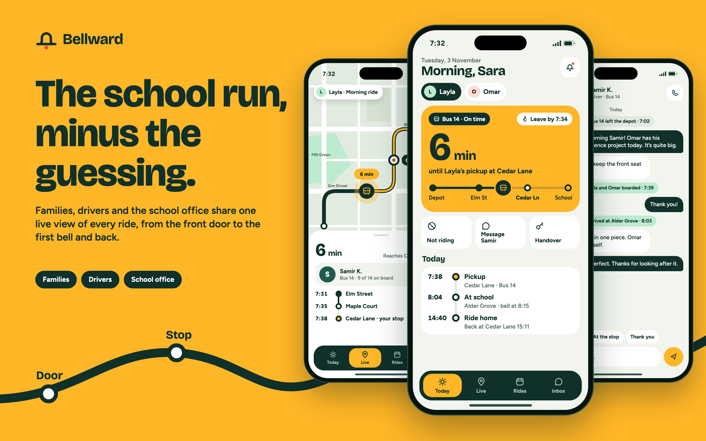
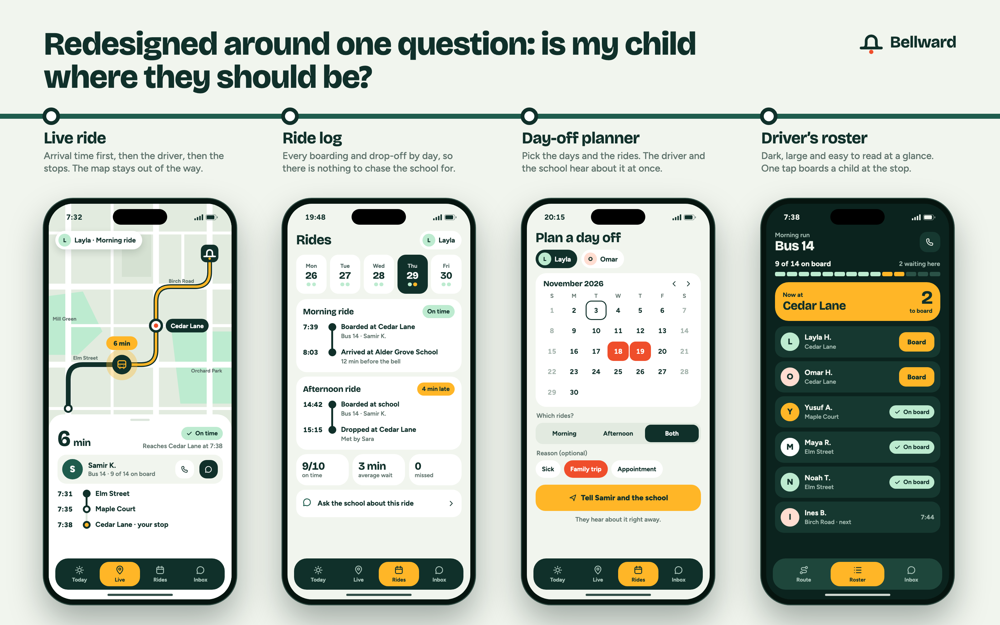
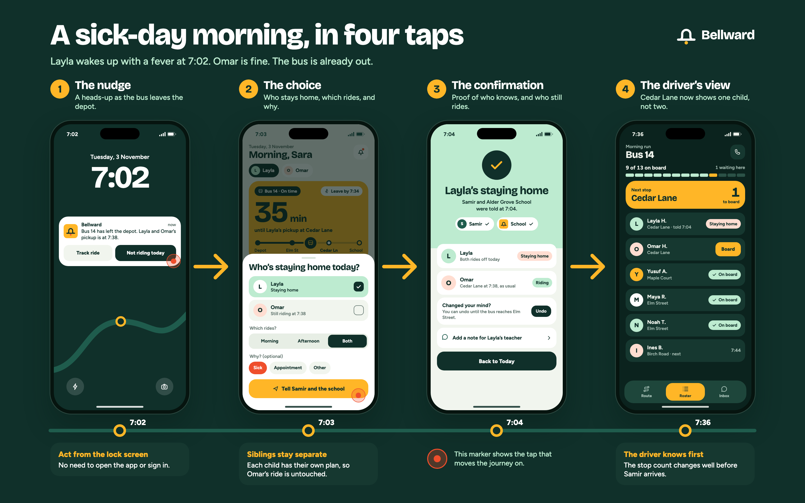
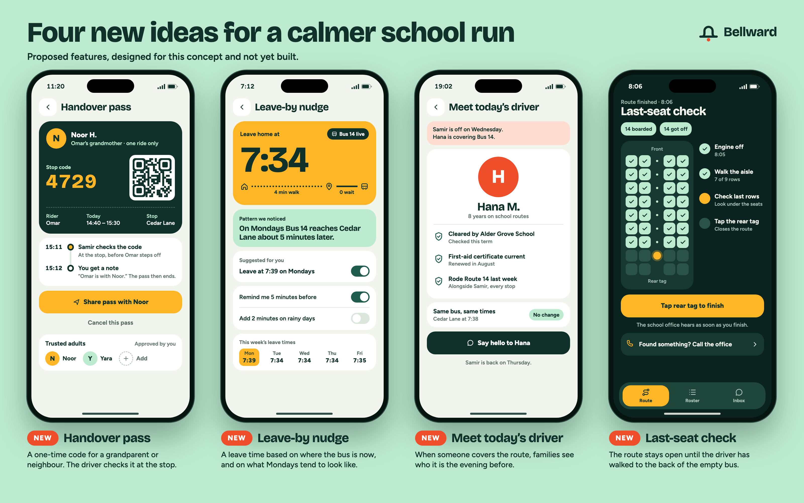
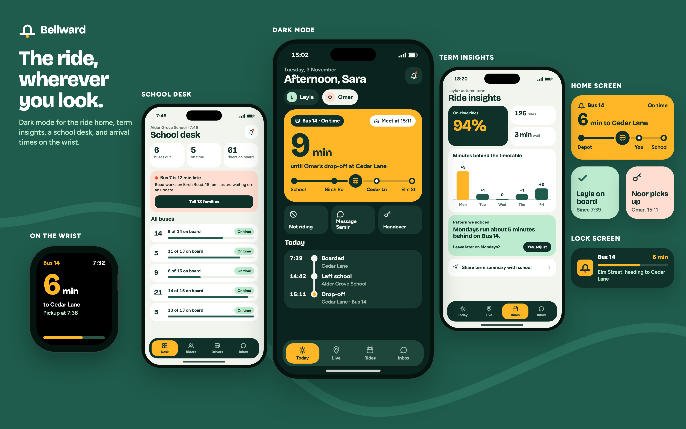

# Bellward

**From the door to the bell, and back.**

> **This is a product concept.** Bellward is not published on the App Store or Google Play. It is based on an earlier project, and every name, school, route and number in the images is invented.

## Introduction

Bellward is a school-bus app concept for families, drivers and school offices. I gave it a new name, a new identity and a new structure, then redesigned the key screens from scratch around one idea: everyone involved in a child's ride should be looking at the same picture of it.

The visual language comes from the ride itself. A thick route line with stop markers runs through the product, from the progress bar on the home screen to the boards in this case study. Blackboard green and marigold give it a school feel without turning it into a children's app, because the people using it are parents and drivers working to a schedule.

## What it does

- Tells families how many minutes remain until the bus reaches their stop, and when to leave home
- Logs each boarding and drop-off, by child and by day
- Lets a parent take a child off a ride and tells the driver and the school straight away
- Gives drivers a stop-by-stop roster where one tap boards a child
- Gives the school office a single view of every bus and a quick way to update affected families
- Keeps messages between families and drivers next to the ride they are about

## The problem

The school run depends on information that rarely reaches the right person in time. A parent at the stop can't tell whether the bus is two minutes away or twenty. A driver waits at a stop for a child who is at home with a fever. When a bus runs late, the school office finds out from worried parents and answers the same question again and again.

The facts usually exist somewhere. They just aren't in front of the person who needs them, and that person often has thirty seconds and one free hand.

## Who it's for

- **Parents and guardians** who want to know where the bus is and whether their child arrived, without calling anyone
- **Drivers** who need an accurate list at each stop and can't spend time reading a long screen
- **School office staff** who look after several routes at once and need to spot and explain delays early

## Main features (redesigned)

- **Today.** The home screen answers the first question of the morning in one large number, followed by a leave time and the day's rides. Each child has their own view.
- **Live ride.** Arrival time comes first, then the driver, then the stops. The map supports the answer and doesn't compete with it.
- **Ride log.** A week at a glance, with exact times for every boarding and drop-off on the selected day.
- **Day-off planner.** Pick the dates and the rides, add a reason if you want to, and the driver and school are told.
- **Driver's roster.** Dark, high-contrast and built for quick glances. The current stop and the number of children to board sit at the top, and one tap boards a child.
- **Messages and school desk.** Short conversations with the driver, with ride events shown in the thread, and a desk where the school office sees all its buses together.

The journey I cared about most is the one that goes wrong: a child wakes up sick while the bus is already out.

A parent can act from the lock screen, choose one child without affecting a sibling, see exactly who has been told, and undo the change if plans shift. The driver's stop count is correct long before the bus reaches the stop.

## New proposed features

> **These are proposals made for this concept. None of them are implemented.**

- **Handover pass.** A one-ride code for a grandparent or neighbour. The driver checks it at the stop, the parent gets a note, and the pass ends.
- **Leave-by nudge.** A leave time based on where the bus is now and how the route usually behaves. A "Pattern we noticed" card might point out that Mondays run late, and "Suggested for you" offers a later Monday leave time.
- **Meet today's driver.** When someone covers the route, families see who it is the evening before, along with the checks the school has completed.
- **Last-seat check.** The route stays open until the driver has walked to the back of the empty bus and tapped a tag at the rear.

I also explored how the ride could appear outside the main app screens: dark mode for the ride home, term insights, a watch view, and home-screen and lock-screen widgets.

## From prototype to product

| Area | In this concept | Before it could ship |
| --- | --- | --- |
| Family app | Today, live ride, ride log, day-off planner and messages, designed as static screens | Test with parents on real school mornings, including one-handed use at the stop |
| Driver roster | Stop-by-stop roster with one-tap boarding | Trial on a real route, and agree when drivers may touch the screen |
| School desk | Overview of all buses and delay updates | Work with office staff on adding and changing riders and drivers during term |
| Proposed features | Handover pass, leave-by nudge, meet today's driver, last-seat check | Decide with schools what comes first, and agree the rules for who may collect a child |
| Privacy and trust | Families see only their own child's ride | Set consent, retention and access rules for children's location and attendance records with schools and guardians |
| Rollout | No live service | Pilot with one school and a few routes, then measure missed stops, calls to the office and time spent waiting |

## The concept and its value

Bellward treats the school run as one shared journey with three audiences, not as a tracking map with some admin screens attached. Families get fewer unknowns, drivers get a list they can trust at every stop, and school offices get to explain a delay before anyone has to ask.

The identity supports that. The bell mark points to where every morning ride is heading, and the route line makes progress readable at a glance on a phone, a watch or a lock screen.

**Palette**

- Blackboard `#10302A`: ink and dark surfaces
- Pine `#1F5C4D`: route lines and secondary surfaces
- Marigold `#FFB627`: the live bus and main actions
- Tomato `#EF4E2B`: alerts, delays and new-feature tags
- Mint `#BDEBD0`: on board and confirmed states
- Blush `#FFDDD1`: absence and gentle alerts
- Chalk `#F1F5EE`: app background
- Sage `#5F736C`: secondary text

**Typography:** Bricolage Grotesque for headlines and arrival times, Figtree for the interface and captions.

---

Product concept by Ziad Abdellah.
